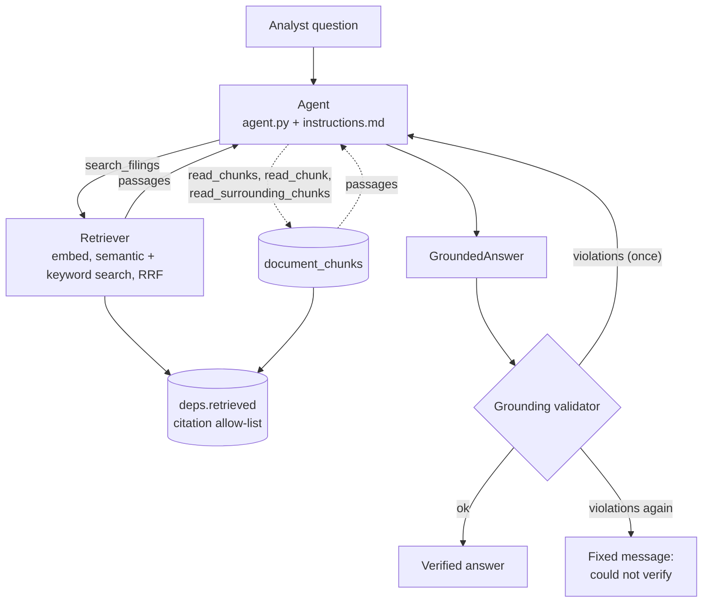
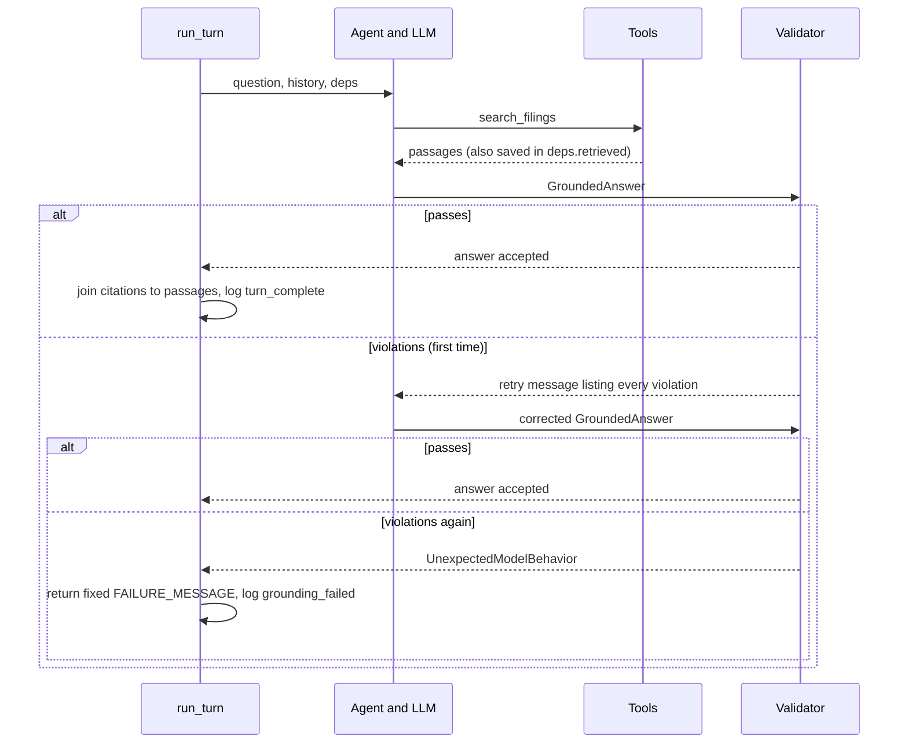

# Research pipeline: retrieval → agent → grounding

How an analyst question turns into a cited, verified answer. Retrieval finds candidate passages from the filings, a PydanticAI agent reads them through tools and writes a structured answer, and a grounding validator checks every citation before the answer is allowed out.

The chat layer ([../chat/orchestrator.py](../chat/orchestrator.py) `run_turn`) calls this pipeline once per question. What it does with the result (saving, streaming) is outside this document.

> **Status:** built, unit-tested with scripted fake models, and run live against Gemini (`gemini-3.1-flash-lite`) on the five-company corpus; see [Smoke tests](#smoke-tests) for what has been checked.

## Full pipeline

The turn starts in `../chat/orchestrator.py`, where `run_turn` sends the analyst's question and recent history to the PydanticAI agent defined in `agent.py`, with the product contract from `instructions.md` and the four tools from the same file. The instructions tell the model to call `search_filings` first; that tool delegates to `../retrieval/retriever.py`, which embeds the query, runs semantic (pgvector) and keyword (Postgres full-text) search in parallel, fuses the two rankings with Reciprocal Rank Fusion, and loads the winning chunks with their filing metadata. The agent then decides whether the returned passages are enough to answer: if they are, it produces the final `GroundedAnswer`; if not, it can call `read_chunks`/`read_chunk` for full chunk text, or `read_surrounding_chunks` when it needs the text around a passage. Every tool response is recorded in `deps.retrieved` (from `deps.py`), so the final citations are limited to chunks actually retrieved during that turn. When the agent returns, `../grounding/validator.py` runs as its output validator and compares the structured answer against that record: it checks the answer and citation contract, verifies every `[n]` marker has a matching citation, rejects chunk ids that were never retrieved, and requires each quote to be copied verbatim from the retrieved chunk text. A failure sends the violations back to the model for one retry; a second failure makes `run_turn` return a fixed "could not verify" message instead. Only a verified answer, joined with its source passages, is handed back to the chat layer to persist and stream.

## Diagram



Unlike a typical hybrid search setup, keyword search here does not use an LLM to extract keywords: the question's own words are OR'ed into the full-text query. The agent's `search_filings` also asks for no neighbor chunks; it uses `read_surrounding_chunks` when it wants context.

## Stage 1: the agent

`agent.py` defines one module-level `agent`.

| Setting | Value |
| --- | --- |
| Model | `settings.llm_model` (Gemini), through PydanticAI's native Google client, retried up to 5 times on HTTP 503 / 429. The OpenAI-compatible Gemini endpoint is not used: it drops the thought signatures Gemini 3 needs between tool calls |
| Deps | `DocumentAgentDeps`: `user_id`, `thread_id`, `retriever`, `retrieved` |
| Output | `GroundedAnswer` |
| Instructions | `instructions.md`, loaded once at import |
| Retries | tools: 2, output: 1 |

### What the instructions tell the model

`instructions.md` is the product contract. In short:

- Search first, filter by `ticker` and `fiscal_year` when the question names them. Keep tool rounds to a minimum: answer from search results when they are enough, batch reads into one call, never re-fetch a passage.
- Answer only from passages the tools returned this turn.
- Every factual claim gets a `[n]` marker plus a citation with the `chunk_id` and a `quote` copied verbatim from that passage. Markers restart at `[1]` every answer.
- If the filings do not support an answer, set `insufficient_evidence`, say what is missing, give no citations, and never substitute another company or year. Answer the supported part of a partly supported question.
- Report what the filings say; do not infer causes they do not state (the generative-AI-margins case); no investment advice.

### Tools

| Tool | What it does | Where the data comes from |
| --- | --- | --- |
| `search_filings(query, ticker?, fiscal_year?, form_type?)` | Hybrid search, returns up to `retrieval_top_k` passages with no neighbor text. Each passage carries only its first 800 characters (`truncated` says so); `read_chunks` returns full text. Ticker is upper-cased. If nothing matches, a `note` tells the model the filing is not in the corpus and to answer with `insufficient_evidence`. | `DocumentRetriever.search` (stage 2) |
| `read_chunks(chunk_ids)` | Several passages in one query, at most 10 ids. Fails the call if none exist. | `DocumentRetriever.read_chunks` |
| `read_chunk(chunk_id)` | One passage by id. | `DocumentRetriever.read_chunk` |
| `read_surrounding_chunks(chunk_id, window)` | A passage plus the text of the chunks around it. Window is clamped to 1 to 3. | `DocumentRetriever.read_chunk` with a neighbor window |

Every tool returns, for each passage: `chunk_id`, `ticker`, `form_type`, `fiscal_year`, `filing_date`, `section`, `page` and `content`. Neighbor text from `read_surrounding_chunks` comes back as `context_before` and `context_after`; it has no chunk id, so the model can read it but cannot cite it.

An unknown id raises `ModelRetry`, which tells the model "no such chunk, use an id from `search_filings`" and lets it try again.

### The allow-list

`deps.retrieved` is a dict from `chunk_id` to `SourcePassage`. Each tool adds what it returned. It is the only thing a citation may point at, which is how the pipeline guarantees the model cannot cite a chunk it never saw.

## Stage 2: retrieval

`search_filings` calls `DocumentRetriever.search`. Full detail and defaults are in [../retrieval/README.md](../retrieval/README.md). In short:

1. **Embed** the query into a 1024-dimension vector with NVIDIA's embedding model (one request, `input_type` `query`).
2. **Semantic search**: nearest chunks by cosine distance, `retrieval_candidate_k` (50) of them.
3. **Keyword search**, in parallel: the question's words OR'ed into a Postgres full-text query, ranked by `ts_rank_cd`, also 50 candidates.
4. **Fuse** the two ranked lists with Reciprocal Rank Fusion (`k` = 60). A chunk found by both searches beats a chunk found by one.
5. **Keep** the best `retrieval_top_k` (8) and load their text and filing metadata.

Filters (`ticker`, `fiscal_year`, `form_type`) apply to both searches.

## Stage 3: the answer

The model returns a `GroundedAnswer`:

| Field | Meaning |
| --- | --- |
| `answer` | Text with inline `[1]`, `[2]` markers |
| `citations` | One entry per marker: `marker`, `chunk_id`, `quote` |
| `insufficient_evidence` | `true` when the filings cannot support an answer; `citations` must then be empty |

## Stage 4: grounding

`grounding/validator.py` is the trust contract in code. It is registered as the agent's **output validator**, so it runs automatically on every answer the model returns. `validate_answer(answer, retrieved)` returns a list of violations; an empty list means the answer may be shown.

| # | Check | Violation message (shortened) |
| --- | --- | --- |
| 1 | The answer text is not empty | answer text is empty |
| 2 | If `insufficient_evidence`: there are no citations, and nothing else is checked | must not include citations |
| 3 | Otherwise: at least one citation | no citations |
| 4 | No marker is used twice, and markers run 1, 2, 3... without gaps | used by more than one citation / without gaps |
| 5 | Each `chunk_id` is in `deps.retrieved` | was not retrieved this turn |
| 6 | Each `quote` appears verbatim in its chunk's `content`. Whitespace, typographic quotes and dashes are ignored; `...` may skip text if every part is verbatim | quote does not appear in its chunk |
| 7 | Each `[n]` in the text has a citation and each citation is referenced in the text. Each marker has its own brackets (`[1][2]`, not `[1, 2]`) | has no citation / never referenced / write each marker in its own brackets |
| 8 | Exact figures (such as `109,158`) written next to a marker appear in a chunk that marker cites, or are a difference or sum of such figures | does not appear in the chunk(s) cited |

It is deterministic and costs no model call. It proves that sources were really retrieved, that quotes are real, and that exact figures come from the cited chunks. Check 8 skips rounded values ("$96.2 billion"), years, lines without a marker, and segments that say they are a calculation ("calculat", "approximately", "pp"). It does not prove that a claim follows from its quote, or that the model's own arithmetic is right; that would need an LLM judge, which is not built.

### What happens on a failure



| Situation | Result |
| --- | --- |
| Violations on the first answer | Sent back to the model as one retry |
| Violations again | `run_turn` returns the fixed message and no citations; the unverified text is never exposed |
| Corpus has no evidence | The model sets `insufficient_evidence`; the answer has no citations |
| Model or API error (for example HTTP 429 or 504) | The exception propagates to the caller; the chat route turns it into HTTP 502 |

## Worked example

Question: *How did Apple's Services revenue change in FY2025?*

1. The model calls `search_filings(query="Apple Services net sales fiscal 2025", ticker="AAPL", fiscal_year=2025)`.
2. Retrieval embeds the query, runs both searches, fuses them and returns 8 passages. They are stored in `deps.retrieved`, and the model receives them, one of them with `content` such as *"Services net sales were $96.2 billion in 2025, up 13% from 2024."*
3. The model answers: *"Services net sales rose 13% to $96.2 billion in fiscal 2025 [1]."* with one citation: `marker 1`, that passage's `chunk_id`, `quote "Services net sales were $96.2 billion"`.
4. The validator finds the `chunk_id` in `deps.retrieved`, the quote inside the passage text, and `[1]` matching citation 1. No violations.
5. `run_turn` joins the citation with its passage (ticker, form type, fiscal year, filing date, section, excerpt) and returns the `VerifiedAnswer`.

For *"What was Tesla's total revenue in 2024?"* about a company that is not in the corpus (say Tesla), `search_filings` with `ticker="TSLA"` returns an empty list, the model sets `insufficient_evidence` and says the filings do not cover Tesla, and the validator accepts it because it has no citations.

## Logging

structlog events printed to the console:

| Event | Fields |
| --- | --- |
| `tool_finished` | `tool`, `seconds`, result count; query and filters for searches |
| `turn_complete` | `seconds`, `model_requests`, `input_tokens`, `output_tokens`, `token_details` (for example reasoning tokens), `passages_retrieved`, `citations`, `insufficient_evidence` |
| `grounding_failed` | `seconds`, error |

Most of a turn's time is expected to be model latency, not retrieval. This is why the instructions push for few tool rounds and batched reads.

## Module map

| File | Role |
| --- | --- |
| `agent.py` | Agent definition, the four tools, the grounding output validator |
| `deps.py` | `DocumentAgentDeps` and the `retrieved` allow-list |
| `outputs.py` | `GroundedAnswer`, `Citation`, `VerifiedAnswer`, `VerifiedCitation` |
| `instructions.md` | System prompt and product contract |
| `progress.py` | `tool_timer`, used by the tools for timing logs |
| `../retrieval/` | Hybrid search (embed, vector and full-text search, RRF) |
| `../grounding/validator.py` | Citation validation |
| `../chat/orchestrator.py` | `run_turn`: runs the agent, joins citations, fails closed |

## Smoke tests

Run from `backend/`. Both make live embedding and model calls, so they use free-tier quota.

```bash
uv run python -m scripts.smoke_retrieval
uv run python -m scripts.smoke_assistant apple-mix
```

`smoke_assistant` takes a query key: `apple-mix`, `apple-suppliers`, `amazon-aws`, `tesla-revenue` (expect "not enough evidence": Tesla is not in the corpus), `q10-refusal` and `underspecified` (expect a clarifying question, no search). On Windows set `PYTHONUTF8=1` so the answer prints. It runs the same `run_turn` the chat endpoint uses and prints the answer, whether it was grounded, and each citation with its quote and excerpt.

## Tests

No network or database; the model is a scripted fake.

- `tests/grounding/test_validator.py`: every validator rule
- `tests/assistant/test_agent.py`: tool behavior, retry then fail, corrected answer accepted
- `tests/assistant/test_orchestrator.py`: verified answer, fail closed, insufficient evidence
