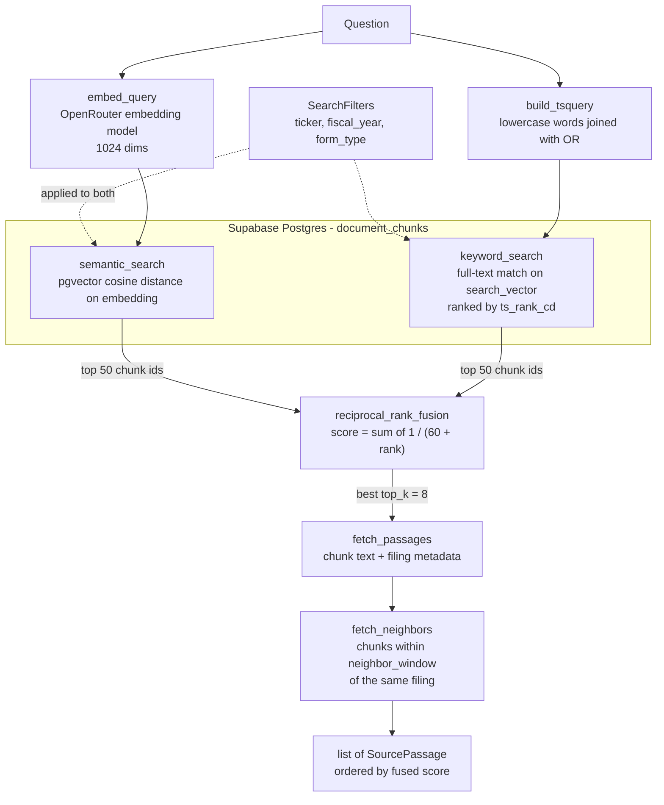

# Retrieval

Turns a question into a ranked list of source passages from the ingested filings. It knows nothing about the LLM, so it can be tested and tried on its own. For the full path from analyst question to verified answer (agent tools, grounding), see [../assistant/README.md](../assistant/README.md).

## How it works

`DocumentRetriever.search(query)` runs hybrid search: one semantic ranking and one keyword ranking, merged with Reciprocal Rank Fusion (RRF).



The two searches run concurrently (`asyncio.gather`, each on its own database connection) and each returns only chunk ids. Text and metadata are fetched once, for the winners only.

1. **Embed.** The query becomes a vector with `settings.embedding_model`. If the API returns more than `embedding_dimensions` values, the vector is cut to that length and rescaled to unit length (`fit_dimensions`).
2. **Semantic search.** Chunks are ordered by cosine distance (`embedding <=> query`, closest first) to the query vector, with the chunk id as a tie-breaker so results are stable.
3. **Keyword search.** The question's words are lowercased and joined with OR, then matched with `to_tsquery('english', ...)` against the generated `search_vector` column (`@@`) and ranked by `ts_rank_cd`. Only chunks that match at least one word are candidates. OR is used because `websearch_to_tsquery` ANDs every term, which matches nothing for a natural-language question. Only word characters are kept, so the query is always valid tsquery syntax. If no words remain, keyword search returns nothing.
4. **Fuse.** RRF combines the two ranked lists using ranks only, because cosine distance and `ts_rank_cd` are on unrelated scales. A chunk found by both searches beats a chunk found by one. Ties keep first-seen order, so results are deterministic.
5. **Fetch.** The top results are loaded with their filing metadata (ticker, form type, fiscal year, filing date, section, page).
6. **Add neighbors.** Each passage gets the text of adjacent chunks from the same filing as `context_before` and `context_after`. This is context only: neighbors are never ranked and have no chunk id of their own.

## Default settings

The tuning knobs live in `app/config.py` and can be overridden with an environment variable of the same name (for example `RETRIEVAL_TOP_K=10` in `backend/.env`). Arguments passed to `DocumentRetriever.search` override them per call.

| Setting | Default | Meaning |
| --- | --- | --- |
| `retrieval_top_k` (`top_k`) | `8` | Passages returned after fusion. |
| `retrieval_candidate_k` (`candidate_k`) | `50` | Candidates taken from each of the two searches before fusion. |
| `retrieval_neighbor_radius` (`neighbor_window`) | `1` | Chunks added on each side of a passage. `0` turns it off. |
| `retrieval_rrf_k` | `60` | RRF smoothing constant. A higher value flattens the difference between ranks. |
| `filters` | none | `SearchFilters`: `ticker`, `fiscal_year`, `form_type`. All optional, combined with AND. Argument only. |

| Fixed setting | Value | Where | Meaning |
| --- | --- | --- | --- |
| Embedding model | `settings.embedding_model` | `app/config.py` | Set in `.env`; the project uses `nvidia/nemotron-3.5-embed-8b:free`. |
| Embedding dimensions | `settings.embedding_dimensions` | `app/config.py` | Must match the `vector(1024)` column. |
| Embedding retries | `6` | `embeddings.py` | `max_retries` on the OpenAI client; it handles rate limits (HTTP 429) with backoff. |
| `read_chunk` neighbor window | `0` | `DocumentRetriever.read_chunk` | Fetch one chunk by id with no context unless asked. |

The agent's tools use the settings above, with two overrides in `app/assistant/agent.py`: `search_filings` passes `neighbor_window=0`, so results are the matching chunks only, and `read_surrounding_chunks` asks for a window of 1 to 3. `read_chunks` fetches up to 10 chunks by id in one query (`DocumentRetriever.read_chunks`).

## Search filters

`SearchFilters` narrows both searches before ranking. Every field is optional and the fields combine with AND; an unset field applies no restriction. Filters are applied by joining each chunk to its `source_documents` row.

| Field | SQL condition | Example |
| --- | --- | --- |
| `ticker` | `source_documents.ticker = :ticker` | `"AAPL"` |
| `fiscal_year` | `source_documents.fiscal_year = :fiscal_year` (one year) | `2025` |
| `form_type` | `source_documents.form_type = :form_type` | `"10-K"` |

## Using the retriever

```python
retriever = DocumentRetriever(engine)            # an AsyncEngine; `embed` can be swapped in tests
passages = await retriever.search("supplier concentration", filters=SearchFilters(ticker="AAPL"))
```

| Method | What it does |
| --- | --- |
| `search(query, *, top_k, candidate_k, filters, neighbor_window)` | The full hybrid pipeline above. Unset limits fall back to the settings. One embedding request per call. |
| `read_chunks(chunk_ids)` | Several chunks by id in one query, in the order asked. Unknown ids are skipped. No neighbors. |
| `read_chunk(chunk_id, *, neighbor_window=0)` | One chunk by id, optionally with neighbors. Returns `None` if it does not exist. |

## What comes back

Each result is a `SourcePassage` (`models.py`). It is frozen, and it is the unit citations point at.

| Field | Meaning |
| --- | --- |
| `chunk_id`, `document_id`, `chunk_index` | Identity, and the chunk's position inside its filing |
| `ticker`, `form_type`, `fiscal_year`, `filing_date` | Which filing it came from |
| `section` | The "Item N." heading the chunk sits under, when known |
| `page` | Page number; currently empty, because the source HTML has no page numbers |
| `content` | The full chunk text. Chunks are capped at 512 tokens at ingestion, so nothing is truncated here |
| `score` | The fused RRF score (not a similarity). `0.0` for `read_chunk(s)` results |
| `context_before`, `context_after` | Text of neighboring chunks, in document order. Context only: never ranked, no chunk id |

## How RRF combines the two lists

Each list gives a chunk a score of `1 / (k + rank)`, with `k = 60` and rank starting at 1; a chunk's final score is the sum over the lists it appears in.

| Chunk | Semantic rank | Keyword rank | Score |
| --- | --- | --- | --- |
| A | 1 | 3 | 1/61 + 1/63 = 0.0323 |
| B | 2 | not found | 1/62 = 0.0161 |
| C | not found | 1 | 1/61 = 0.0164 |

A is first because both searches like it, even though it is only third in the keyword list. C edges out B because rank 1 beats rank 2. Only ranks are used because cosine distance and `ts_rank_cd` are on unrelated scales. A larger `k` makes the gap between ranks smaller; a smaller `k` rewards the very top ranks more.

## Files

| File | Role |
| --- | --- |
| `retriever.py` | `DocumentRetriever`: runs the pipeline above. Also `read_chunk` for one chunk by id. |
| `queries.py` | All SQL: both searches, `fetch_passages`, `fetch_neighbors`, and `build_tsquery`. |
| `fusion.py` | `reciprocal_rank_fusion`, pure Python. |
| `embeddings.py` | `embed_query`: one embedding request per search. |
| `models.py` | `SearchFilters` (input) and `SourcePassage` (output). |
| `cli.py` | Try a search from the terminal. |

`backend/scripts/smoke_retrieval.py` runs three Apple questions through the same code (`uv run python -m scripts.smoke_retrieval`).

## Try it

Each run makes one embedding request, which counts against the free tier's daily limit.

```bash
# from backend/
uv run python -m app.retrieval.cli "How did Apple's revenue mix change?" --ticker AAPL
uv run python -m app.retrieval.cli "supplier concentration" --ticker AAPL --year 2025 --top-k 5
```

The CLI accepts `--ticker`, `--year` and `--top-k`. `candidate_k`, `neighbor_window` and RRF `k` are not exposed as flags.

## Tests

`tests/retrieval/` covers fusion ranking, query assembly and the retriever with a mocked database. `test_retrieval_integration.py` is marked `integration` and needs live Supabase and OpenRouter credentials.
