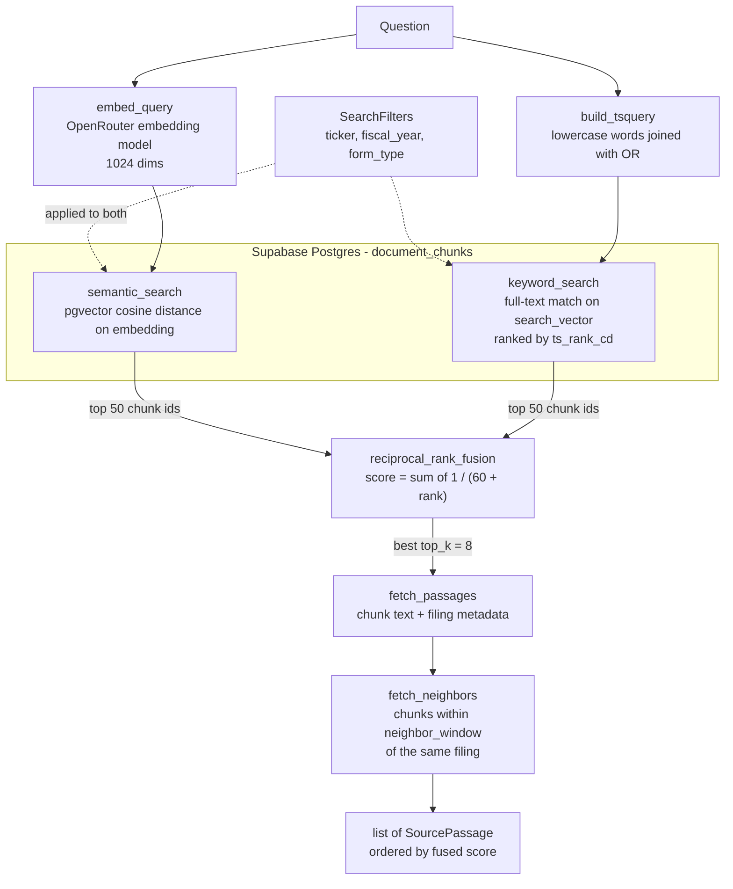

# Retrieval

Turns a question into a ranked list of source passages from the ingested filings. It knows nothing about the LLM, so it can be tested and tried on its own.

## How it works

`DocumentRetriever.search(query)` runs hybrid search: one semantic ranking and one keyword ranking, merged with Reciprocal Rank Fusion (RRF).



The two searches run concurrently and each returns only chunk ids. Text and metadata are fetched once, for the winners only.

1. **Embed.** The query becomes a vector with `settings.embedding_model`. If the API returns more than `embedding_dimensions` values, the vector is cut to that length and rescaled to unit length (`fit_dimensions`).
2. **Semantic search.** Chunks are ordered by cosine distance to the query vector.
3. **Keyword search.** The question's words are lowercased and joined with OR, then matched against the `search_vector` column and ranked by `ts_rank_cd`. OR is used because `websearch_to_tsquery` ANDs every term, which matches nothing for a natural-language question. Only word characters are kept, so the query is always valid tsquery syntax. If no words remain, keyword search returns nothing.
4. **Fuse.** RRF combines the two ranked lists using ranks only, because cosine distance and `ts_rank_cd` are on unrelated scales. A chunk found by both searches beats a chunk found by one. Ties keep first-seen order, so results are deterministic.
5. **Fetch.** The top results are loaded with their filing metadata (ticker, form type, fiscal year, filing date, section, page).
6. **Add neighbors.** Each passage gets the text of adjacent chunks from the same filing as `context_before` and `context_after`. This is context only: neighbors are never ranked and have no chunk id of their own.

## Default settings

| Setting | Default | Where | Meaning |
| --- | --- | --- | --- |
| `top_k` | `8` | `DocumentRetriever.search` | Passages returned after fusion. |
| `candidate_k` | `50` | `DocumentRetriever.search` | Candidates taken from each of the two searches before fusion. |
| `neighbor_window` | `1` | `DocumentRetriever.search` | Chunks added on each side of a passage. `0` turns it off. |
| `filters` | none | `SearchFilters` | `ticker`, `fiscal_year`, `form_type`. All optional, combined with AND. |
| RRF `k` | `60` | `fusion.reciprocal_rank_fusion` | Smoothing constant. A higher value flattens the difference between ranks. |
| Embedding model | `settings.embedding_model` | `app/config.py` | Set in `.env`; the project uses `nvidia/nemotron-3.5-embed-8b:free`. |
| Embedding dimensions | `settings.embedding_dimensions` | `app/config.py` | Must match the `vector(1024)` column. |
| Embedding retries | `6` | `embeddings.py` | `max_retries` on the OpenAI client; it handles rate limits (HTTP 429) with backoff. |
| `read_chunk` neighbor window | `0` | `DocumentRetriever.read_chunk` | Fetch one chunk by id with no context unless asked. |

The agent's tools override a few of these in `app/assistant/agent.py`: `search_filings` uses `top_k=8` and `neighbor_window=0`, so results are the matching chunks only. `read_surrounding_chunks` asks for a window of 1 to 3.

## Files

| File | Role |
| --- | --- |
| `retriever.py` | `DocumentRetriever`: runs the pipeline above. Also `read_chunk` for one chunk by id. |
| `queries.py` | All SQL: both searches, `fetch_passages`, `fetch_neighbors`, and `build_tsquery`. |
| `fusion.py` | `reciprocal_rank_fusion`, pure Python. |
| `embeddings.py` | `embed_query`: one embedding request per search. |
| `models.py` | `SearchFilters` (input) and `SourcePassage` (output). |
| `cli.py` | Try a search from the terminal. |

## Try it

Each run makes one embedding request, which counts against the free tier's daily limit.

```bash
# from backend/
uv run python -m app.retrieval.cli "How did Apple's revenue mix change?" --ticker AAPL
uv run python -m app.retrieval.cli "supplier concentration" --ticker AAPL --year 2025 --top-k 5
```

The CLI accepts `--ticker`, `--year` and `--top-k`. `candidate_k`, `neighbor_window` and RRF `k` are not exposed as flags.

## Tests

`tests/retrieval/` covers fusion ranking, query assembly and the retriever with a mocked database. `test_retrieval_integration.py` is marked `integration` and needs live Supabase and OpenRouter credentials.
